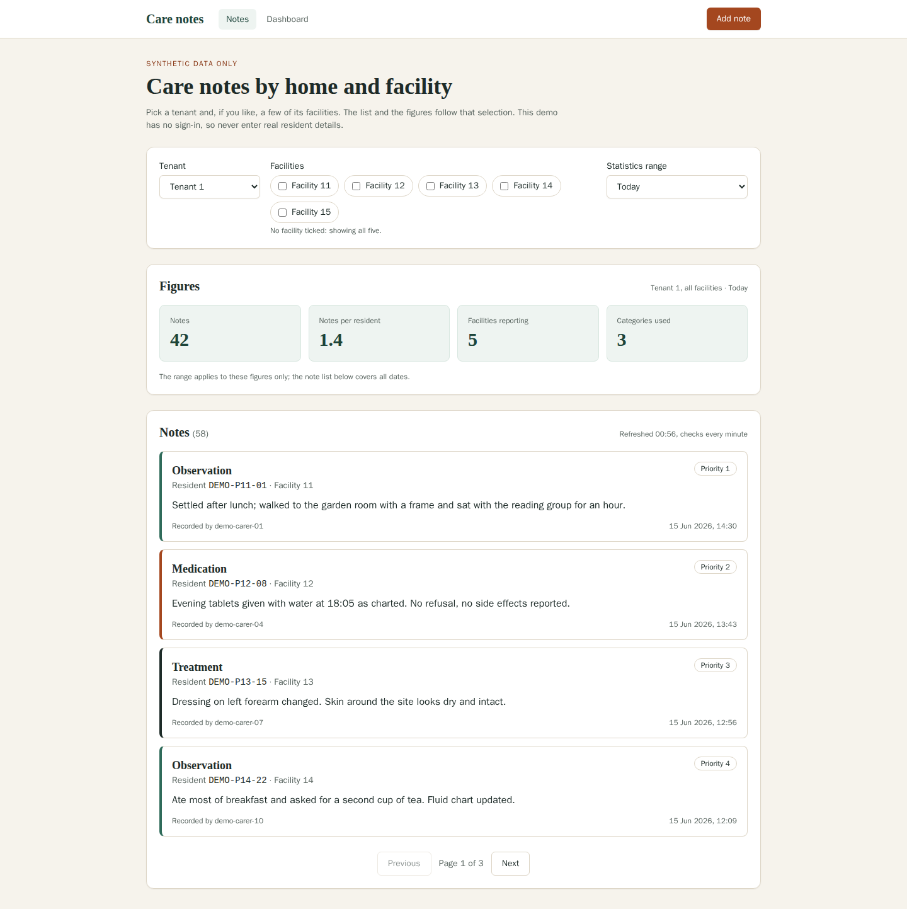
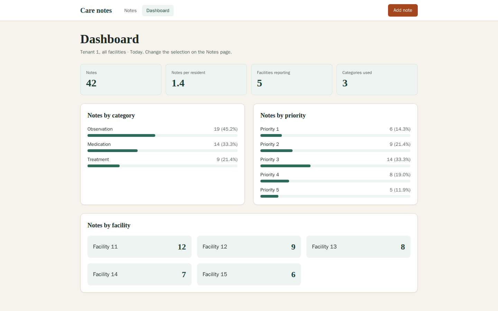
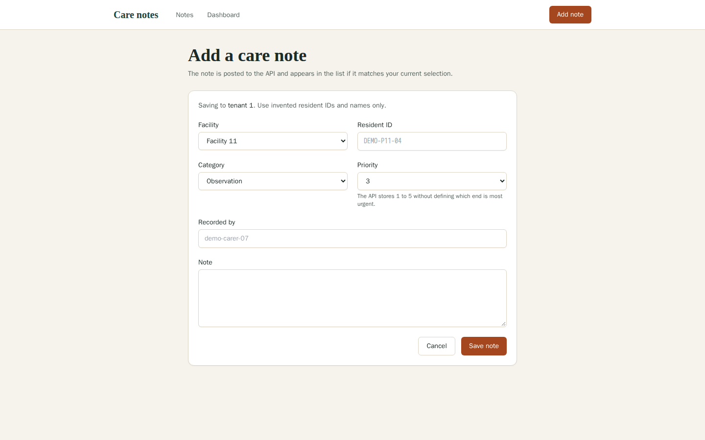
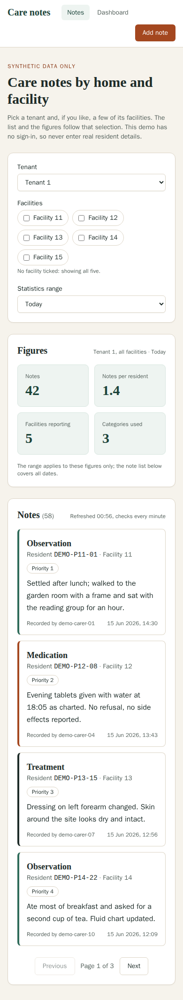
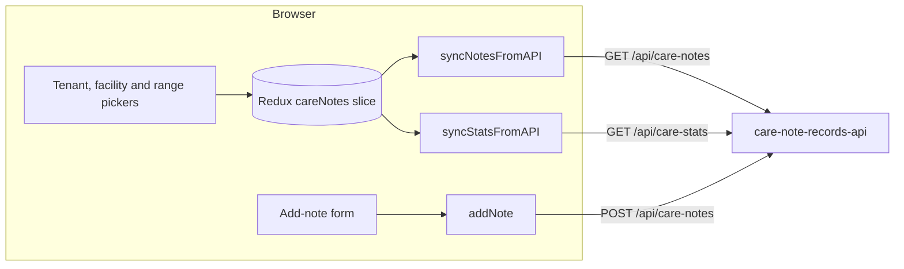

# Care notes web client

A small Next.js client for a care-home notes API. Staff pick a tenant (a care provider) and, optionally, some of its facilities; the app then lists the matching care notes page by page, summarises them for a chosen date range, and lets someone add a new note to the selected tenant.

It is a demo built against synthetic data. There is no sign-in, and the tenant and facility pickers are filters, not access control. Do not point it at real resident records.



| Dashboard | Add a note | Phone (390 px) |
| --- | --- | --- |
|  |  |  |

Every resident ID, carer name and figure in the screenshots is invented. They were captured with Playwright against mocked API responses, not a live service.

## What it does

- **Notes** (`/`): tenant selector, a checkbox per facility (none ticked means all five), and a statistics range. The note list is paginated 20 at a time and polls every minute; the figures follow the same tenant and facilities for the chosen range.
- **Dashboard** (`/dashboard`): the same figures broken down by category, priority and facility for the current selection.
- **Add a note** (`/add-note`): posts a note to the selected tenant and a chosen facility. If saving fails, the draft stays in the form.

Priorities are shown as plain numbers 1 to 5 with one neutral colour. The API does not say whether 1 or 5 is the most urgent, so the UI does not guess.

## Running it

The app lives in `Test-frontend/care-notes-app/`. It needs Node 22 (see `.nvmrc`) and the companion API, **care-note-records-api**, which is set up separately and listens on `http://localhost:8000` by default.

```sh
cd Test-frontend/care-notes-app
npm ci
cp .env.example .env.local   # NEXT_PUBLIC_API_URL, defaults to http://localhost:8000
npm run dev                  # http://localhost:3000
```

The client calls `${NEXT_PUBLIC_API_URL}/api/...`. The API must allow the client's origin through CORS; its default allows `http://localhost:3000`. Anything in a `NEXT_PUBLIC_` variable ends up in the browser bundle, so never put credentials there.

### With Docker

The Dockerfile has a test stage and a production stage:

```sh
cd Test-frontend/care-notes-app
docker build --target test -t care-notes-web:test .   # lint, type-check, tests
docker build --build-arg NEXT_PUBLIC_API_URL=http://localhost:8000 -t care-notes-web .
docker run --rm -p 3000:3000 care-notes-web
```

`NEXT_PUBLIC_API_URL` is a build argument because Next.js inlines it into the bundle at build time. The production image runs Next's standalone server as the non-root `node` user.

## Checks

```sh
npm test            # Vitest + Testing Library, 45 tests
npm run lint        # ESLint with next/core-web-vitals and next/typescript
npm run type-check  # next typegen, then tsc --noEmit
npm run build
```

The tests stub `fetch`, so none of them need the API. They cover the reducer, the tenant and facility helpers, the API client, date parsing, and the main components and screens.

## How it fits together



A notes request from the client looks like this:

```
GET /api/care-notes?tenant_id=1&page=2&page_size=20&facility_ids=11,13
```

The client expects the API's paginated shape back:

```json
{
  "notes": [
    {
      "id": 412,
      "tenant_id": 1,
      "facility_id": 13,
      "patient_id": "DEMO-P13-15",
      "category": "treatment",
      "priority": 3,
      "created_at": "2026-06-15T12:56:00",
      "created_by": "demo-carer-07",
      "note_content": "Synthetic demo note for fictional resident DEMO-P13-15"
    }
  ],
  "pagination": { "total": 58, "page": 2, "page_size": 20, "total_pages": 3 }
}
```

`GET /api/care-stats?tenant_id=1&range=this_week&facility_ids=11,13` returns `total_notes`, `by_category`, `by_priority`, `by_facility` and `avg_notes_per_patient`.

## Design notes

- **Stale responses are dropped.** Each notes and stats request records its request ID in the store. Changing the tenant or facilities resets the page and clears those IDs, so a slow answer for the old selection cannot overwrite the new one.
- **Notes and figures fail separately.** A failing `/care-stats` call shows a retry in the figures panel and leaves the note list alone, and the other way round.
- **A new note appears only where it belongs.** After a save, the note is added to the visible list only if it matches the current tenant and facility selection and you are on page 1.
- **Timestamps are UTC.** The API returns times without an offset, so the client reads them as UTC instead of the browser's local time.
- **The facility directory is a demo rule.** The API seeds tenants 1 to 10, each with facilities `tenant × 10 + 1` to `+ 5`. That rule lives in `src/features/careNotes/scope.ts`. A real deployment would load this list from an authorised source.
- **Nothing is stored in the browser.** Selections live in memory and reset on a full reload. An unused PouchDB cache was removed, because keeping care notes in unencrypted browser storage without sign-in is not a safe default.

## Limits

- No authentication or per-user facility access. The backend would need both before it held real records.
- API responses are not validated at runtime. A changed contract shows up as rendering errors rather than a clear message.
- Requests are ignored when stale but not cancelled.

## License

MIT, see [LICENSE](LICENSE).
