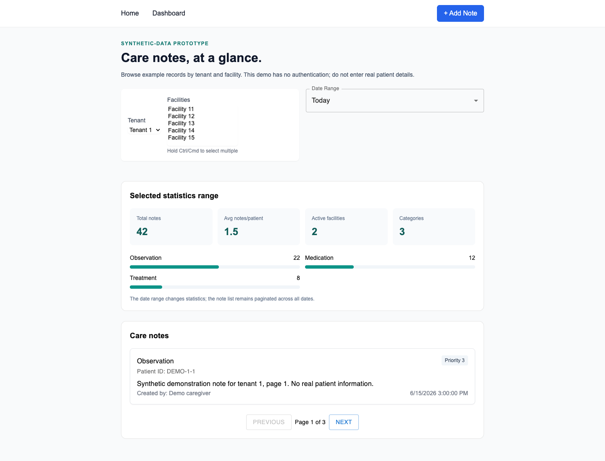
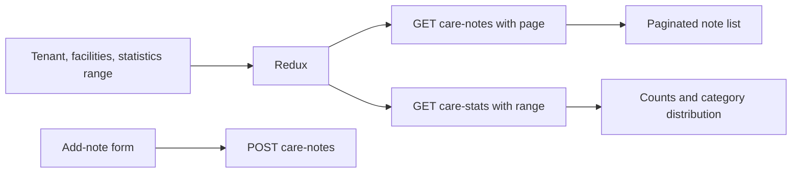

# Care notes browser prototype

A Next.js 15 frontend for a care-note API: browse paginated notes, filter by tenant/facility, view date-range statistics, and create a note. It is a synthetic-data exercise with no authentication or clinical decision support. Tenant filters are query parameters, not access controls.



All names, patient identifiers, notes, and statistics in the screenshots are synthetic fixtures. [Mobile preview](docs/care-notes-mobile.png) uses a fresh browser state. No real care service or patient database was opened for this review.

## Find the actual application

The package lives in **`Test-frontend/care-notes-app/`**, not the repository root. It uses the Next.js App Router; `/`, `/dashboard`, and `/add-note` are the active routes. Reusable screen components live in `src/screens/` so Next does not mistake them for extra Pages Router endpoints. The old React Router entry files remain historical scaffolding, not the running application.

The prior README claimed edit/delete, advanced search, and basic authentication. Those features are not implemented and are not advertised here. There are no uploads, exports, live collaboration, or validated offline synchronization.

## Local run

Use Node.js 22. The reviewed install uses npm and the checked-in npm lock; the duplicate pnpm lock was removed.

```sh
cd Test-frontend/care-notes-app
npm ci --ignore-scripts
cp .env.example .env.local
npm run dev
```

Open `http://localhost:3000`. `NEXT_PUBLIC_API_URL` selects the public API origin and defaults to `http://localhost:8000`; API calls append `/api`. The companion `care-note-records-api` is a separate setup. Do not put private credentials in a `NEXT_PUBLIC_` variable. API generation and data seeding are not invoked by this frontend.

## Data flow and behavior



Changing tenant clears old notes/statistics and the previous facility selection, and resets the actual pagination field. Facility changes also reset the page. Each notes/statistics request has an active ID; late responses from an older request cannot overwrite the latest view. Notes poll every 60 seconds while the main view is mounted. The statistics date range does not filter note-list dates; the interface says so.

The form uses the selected tenant and a visible facility selector instead of silently posting tenant/facility 1. Tenant/facility options remain hardcoded demo choices, not an authorized facility directory. Failed saves show feedback and retain the draft. A full page reload resets Redux selection to tenant 1; navigation within the application preserves it. There is no browser persistence claim for filters or notes.

Priority semantics were inconsistent in the original form and display. Active views now use neutral numbers/colors until the owner confirms whether 1 or 5 is most urgent. No medical interpretation is inferred. Debug logging of full Redux state and returned statistics was removed.

## Verification

```sh
npm test
npm run type-check
npm run build
```

Three Node reducer tests pass for tenant reset, stale note responses, and invalidated statistics responses. TypeScript checking passes. The production build now validates types instead of ignoring them; the existing build-time lint bypass remains, and a full ESLint configuration/check was not added or claimed.

Chrome checks pass for synthetic notes/stats, pagination, tenant changes, selected-tenant/facility post payloads, failed-save feedback with retained draft and retry, desktop/390px layouts, and no page errors. The first browser harness used a full reload instead of client navigation and an incorrect exact link label; those harness issues were corrected before the successful run. No benchmark endpoint, real note creation, PouchDB database, or live API was executed.

A missing PouchDB declaration package was added for type checking, and stale component field/dispatch types were corrected. The PouchDB helper remains unused by the active views. It is not evidence of offline care records or conflict-safe synchronization.

## Remaining boundaries

Before storing real records, the backend needs authenticated ownership and a deliberate facility/tenant access policy. This client cannot provide those guarantees. Runtime API response validation, separate notes/stats error channels, cancellation of network requests, multi-select usability on touch devices, and a complete accessibility review remain useful next work. The retained legacy dependencies report advisories; no clinical safety, regulatory compliance, live-data freshness, or measured performance claim is made.
